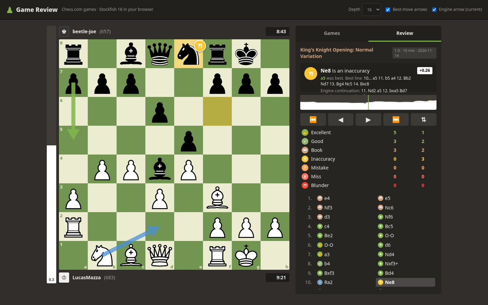

# Game Review (Chess.com-style, free)

**Live:** https://lucasmazza42.github.io/chess-review/

The site GitHub Pages is serving today is still the single-file app at the root of `main` (`index.html`). A Vite + React + TypeScript rebuild lives in [`app/`](app/) and is published to the `gh-pages` branch by GitHub Actions. It is not what the live URL shows until the Pages source is switched (see below).

The root app pulls games from Chess.com's public API and reviews them with Stockfish 18 running in your browser.



## Use it

- Open https://lucasmazza42.github.io/chess-review/ (GitHub Pages, served from the `main` branch root).
- The username box defaults to **LucasMazza**. Click **Load games**, pick a month, then click a game to review it.
- `?user=SomeName` in the URL preloads a different Chess.com username (for example https://lucasmazza42.github.io/chess-review/?user=Hikaru).
- Or paste any standard-chess PGN in **Paste a PGN instead**.
- **Try a move:** once the review finishes, drag or click pieces on the board (legal moves only; promoting pawns open a piece picker). The try is classified with the same labels as the game and compared with the move that was played, for example `Your try Nf3: Excellent (+0.8) vs game move Bc4: Mistake (-0.6)`. Stockfish updates the eval bar, the best-move arrow, and the top lines. Check **Play vs engine** to let the engine answer for the other side, or leave it off and move both sides. The variation is a sub-line in the move list — step it with ← →, **Undo** takes a move back, and **Back to game** returns to the main line. Arrow keys keep working. Trying moves does not change the saved review.
- **Daily Puzzles:** the header link next to Game Review. Each UTC day has two Easy, two Medium, and two Hard puzzles from a bundled subset of the Lichess puzzle database (CC0). Everyone gets the same set that day; the next day is a new set. You play the solving side. A correct move is kept and the opponent's reply is played for you. A wrong move is rejected so you can try again. **Hint** first highlights the piece (and a theme), then shows the destination arrow. **Solution** plays the whole line. **Retry** starts that puzzle over. After you solve a puzzle, or after the solution is shown, **Next puzzle →** jumps to the next unsolved one (Easy, then Medium, then Hard, wrapping around). Enter, N, or → does the same. When all six are solved, that leads to an **All done for today** summary with your streak. **Auto-advance** (saved in this browser) waits about 1.5 seconds after a solve, then moves on. On a phone the next button also sits directly under the board. Solved, revealed, and hint use are stored in this browser, with a streak of consecutive days where all six are solved. Rating and themes stay hidden until you solve the puzzle or show the solution.

Needs an internet connection: Chess.com's public API, plus Stockfish, chess.js, piece images, and the opening list from CDNs (all `https://`). Daily Puzzles also loads `puzzles.json` from the site itself.

## React app

Source is in `app/` (Vite, React, TypeScript, chess.js, react-chessboard). Stockfish still runs in a blob web worker. `app/public/puzzles.json` is the same daily-puzzle set as the root `puzzles.json`. The production base path is `/chess-review/`.

```bash
cd app
npm install
npm run dev
```

Open http://127.0.0.1:5173/chess-review/ . `npm run build` writes `app/dist/`. `npm run preview` serves that build.

On a phone the board uses the full width, moves are tap or drag, Review and Puzzles sit in a bottom tab bar, and the coach and move list collapse under the board. On a wide screen the board stays on the left and the panels on the right. `app/public/manifest.webmanifest` lets the built site be added to a home screen. It is not an offline app: Chess.com, Stockfish, and the opening book still need the network.

Review analysis is still cached as `cr2:<game id>:<depth>`. The opening book is cached as `cr-book-v3` because the React app uses chess.js 1, whose FEN en-passant field does not match the chess.js 0.10.3 book (`cr-book-v2`). Puzzle progress keys are unchanged (`cr-pz`, `cr-pz-auto`).

### Switching GitHub Pages to the React build

Pages is still set to deploy from the `main` branch, and this repo's token cannot change that. After the **Deploy React app** workflow has published the `gh-pages` branch:

1. Open the repository on GitHub → **Settings** → **Pages**.
2. Under **Build and deployment**, set **Source** to **Deploy from a branch**.
3. Set **Branch** to `gh-pages` and **Folder** to `/ (root)`.
4. Save.

https://lucasmazza42.github.io/chess-review/ then serves the React app. Until that save, the URL keeps serving `main`'s root `index.html`.

If the workflow fails with "refusing to allow a GitHub App to create or update workflow" or a 403 when pushing `gh-pages`: **Settings** → **Actions** → **General** → **Workflow permissions** → **Read and write permissions** → Save, then re-run **Deploy React app**.

## Run locally (current live site)

- **Easiest:** double-click `index.html` (works from `file://`; tested in Chrome).
- **Or serve it:** `./start.sh` (or `python3 -m http.server 8000` in this folder) and open http://localhost:8000.
- The page uses relative URLs for its own files (`index.html` and `puzzles.json`) and absolute `https://` URLs for CDN assets, so it also works when the site is hosted under a subpath such as `/chess-review/`. Opening `index.html` directly from disk still runs Game Review; Daily Puzzles needs the folder served (or the GitHub Pages site) so `puzzles.json` can load.

## Features

- Chess.com username (default LucasMazza) → monthly archives with ‹ › month navigation; list shows color, opponent + rating, your rating, result, time control, date. Click to review. Or paste any PGN.
- Stockfish 18 (lite NNUE, single-threaded WASM from unpkg) in a blob Web Worker; no COOP/COEP headers needed. Depth selectable (default 16) with a 5 s per-position cap.
- Move classifications: Brilliant, Great, Best, Excellent, Good, Book, Inaccuracy, Mistake, Miss, Blunder (from win-% loss, Lichess win% formula, mates handled).
- Accuracy per player (Lichess formula), classification counts per player, and Chess.com's own accuracy shown alongside when the API provides it. Click a player's count to jump to that move; click the same count again to cycle through them (a small `1/3` marks the one you're on). Zero counts stay dimmed.
- Board with move highlights tinted by classification, classification badge, green "best move" arrow when you missed it, optional blue engine arrow for the current position, eval bar, clickable eval graph with colored dots for blunders, mistakes, and other key moves, move list with icons, coach box ("X was best", best line, engine continuation, win-% change), clocks from the PGN.
- Book moves + opening name from the Lichess chess-openings database (cached).
- Keyboard: ← → step, ↑/Home start, ↓/End end, F flip.
- Analysis is cached in localStorage per game + depth.
- Daily Puzzles: two puzzles at Easy (under 1300), Medium (1300–1800), and Hard (over 1800), chosen from `puzzles.json` with a UTC-date seed so the set is stable all day and changes the next day. Interactive solving, two-step hints, animated solution, next-puzzle button (Enter / N / →), optional auto-advance, and a local streak. No backend.

## Limitations

- Classifications approximate Chess.com's (their exact algorithm is private); Brilliant uses a simple "piece left en prise" sacrifice check; Great = only move that keeps the advantage (best move ≥20 win% better than the 2nd-best).
- Accuracy uses Lichess's formula, so numbers differ from Chess.com's CAPS.
- Standard chess only (no Chess960 etc.). No Game Rating estimate.
